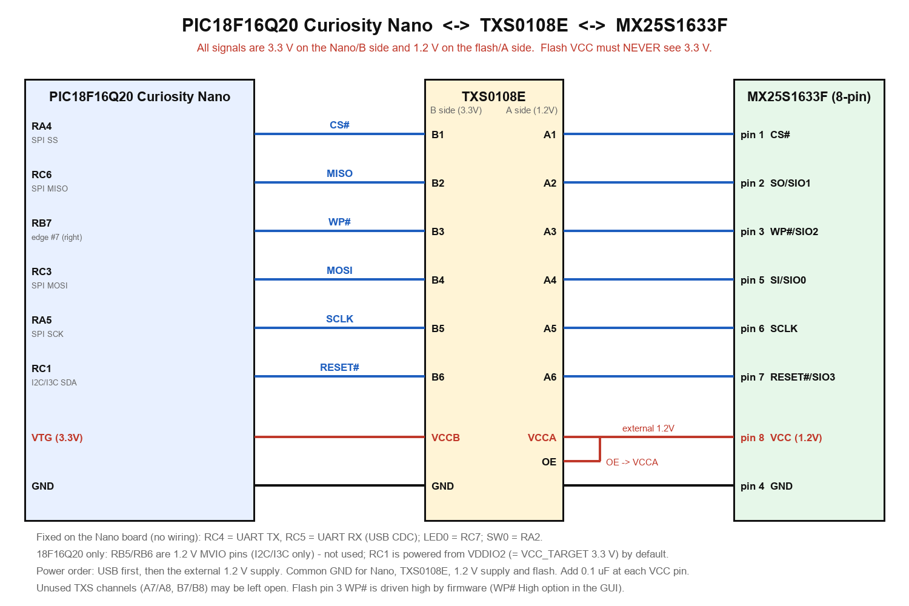
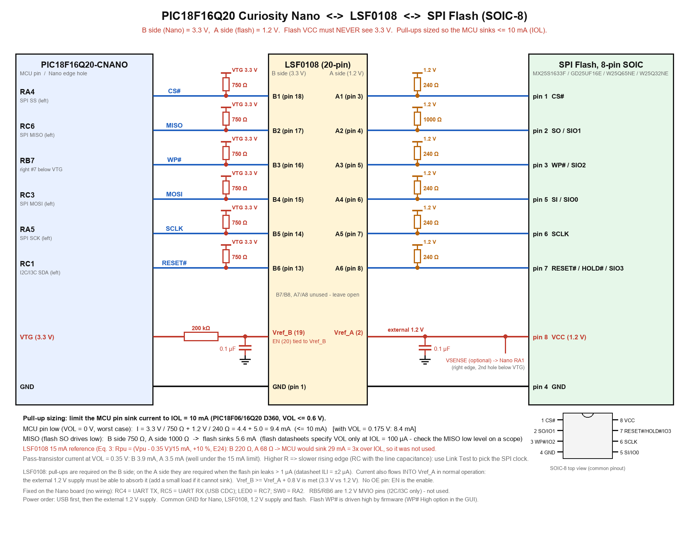

# 硬體接線（PIC18F16Q20-CNANO）

依據 `DOC/PIC18F16Q20-CNANO-UserGuide-DS50003588.pdf`
（Figure 1-3 Pinout、Table 3-2、LED/SW）與 `DOC/MX25S1633FVer13_Microchip.pdf`。



（向量圖：[wiring_CNANO_TXS0108E_MX25S1633F.svg](wiring_CNANO_TXS0108E_MX25S1633F.svg)；由 `tools/make_wiring_diagram.py` 產生）

```
[PC GUI] --USB-C--> [Curiosity Nano]  板載 debugger：USB CDC <-> UART（RC4 TX / RC5 RX，已在板上連好）
                     │ VTG = 3.3V
                     └ 6 條 SPI/控制線 --3.3V--> [TXS0108E  B側 | A側] --1.2V--> [MX25S1633F]
```

## 腳位對照

| 功能 | Nano 邊緣位置 | PIC18F16Q20 | TXS0108E（B→A） | MX25S1633F |
|---|---|---|---|---|
| CS# | 左排 `SPI SS` | RA4 | B1 → A1 | pin 1 CS# |
| MISO | 左排 `SPI MISO` | RC6 | B2 → A2 | pin 2 SO/SIO1 |
| WP# | 右排，VTG 往下第 7 孔 | RB7 | B3 → A3 | pin 3 WP#/SIO2 |
| MOSI | 左排 `SPI MOSI` | RC3 | B4 → A4 | pin 5 SI/SIO0 |
| SCLK | 左排 `SPI SCK` | RA5 | B5 → A5 | pin 6 SCLK |
| RESET# | 左排 `I2C SDA`（18F16Q20 絲印為 I3C1 SDA） | RC1 | B6 → A6 | pin 7 RESET#/SIO3 |
| 3.3V（VCCB） | VTG | VTG | VCCB | — |
| 1.2V（VCCA） | 外接 1.2V 電源 | — | VCCA、**OE** | pin 8 VCC |
| VSENSE（選配） | 右排，VTG 往下第 2 孔 | RA1 | — | 接 1.2V 軌（VCCA / flash VCC），韌體以 ADC 量測 |
| GND | GND | GND | GND | pin 4 GND |

- 左排（USB 朝上，由上往下）：`NC、ID、CDC RX、CDC TX、DBG1、DBG2、UART TX(RC4)、UART RX(RC5)、I2C SDA、I2C SCL、SPI MOSI、SPI MISO、SPI SCK、SPI SS、GND`，**接線以板上絲印為準**。
- 右排（由上往下）：`VBUS、VOFF、DBG3、DBG0、GND、VTG、RA0、RA1、RB5、RB6、RC7(LED0)、NC、RB7、RA2、GND`
  - WP# 用 VTG 往下第 7 孔（RB7）。
- UART（RC4/RC5）、LED0、SW0 都已在板上連接，**不需要額外接線**：
  LED0 = RC7；SW0 = RA2。
- SPI 為韌體 bit-bang（Mode 0），腳位對照表寫在 `firmware/src/main.c` 檔頭。
- Nano 的 USB-C 同時提供：供電、燒錄（`CURIOSITY` 磁碟機）、虛擬序列埠（Curiosity Virtual COM Port）。
- RB5/RB6 屬 VDDIO3 域，板上固定供電 1.2V，只能做 I2C/I3C，本專案不使用；
  RC0/RC1 屬 VDDIO2 域，預設由 VCC_TARGET（3.3V）供電，所以 RC1 可當一般 GPIO。
- 1.2V 可用獨立 LDO；**不要**把 18F16Q20 Nano 上 VDDIO3 的 1.2V（MCP1711，J107）拿來供 flash，電流與雜訊預算不明。

## 替代方案：LSF0108 + SOIC-8 flash（PIC18F16Q20-CNANO）



（向量圖：[wiring_PIC18F16Q20-CNANO_LSF0108_SPIFlash_SOIC8.svg](wiring_PIC18F16Q20-CNANO_LSF0108_SPIFlash_SOIC8.svg)；由 `tools/make_wiring_diagram_lsf0108.py` 產生。
依據 `DOC/LSF0108.pdf`（SDLS966M）與 `DOC/LSF0108_EVK.pdf`。）

信號與 Nano 腳位和上面的 TXS0108E 版完全相同（CS# = RA4、MISO = RC6、WP# = RB7、MOSI = RC3、SCLK = RA5、RESET# = RC1），
只是 TXS0108E 換成 LSF0108，flash 為 8-pin SOIC。**LSF0108 是開關式（pass-gate）轉換器，與 TXS0108E 不同的地方：**

| 項目 | LSF0108 的做法 |
|---|---|
| 方向 | 自動雙向，沒有方向腳、**沒有 OE 腳** |
| 致能 | **EN（pin 20）直接接 Vref_B（pin 19）**，並從 VTG 經 **200 kΩ** 偏壓；Vref_B 旁放 0.1 µF。EN 不可用推挽輸出直接驅動 |
| 電源 | Vref_B（pin 19）= VTG 3.3 V；Vref_A（pin 2）= 外接 1.2 V（同時接 flash pin 8）；要求 Vref_B ≥ Vref_A + 0.8 V（3.3 V / 1.2 V 符合）。無上電順序限制 |
| Vref_A 電流 | 正常工作時有電流**流進** Vref_A，外接 1.2 V 電源必須能吸收，否則 1.2 V 軌會被推高 |
| 通道 | B1~B6（pin 18~13）↔ A1~A6（pin 3~8）；B7/B8、A7/A8 懸空 |
| 上拉電阻 | **兩側都要**（B 側必要；A 側在 flash 腳漏電流 > 1 µA 時必要，資料手冊 ILI = ±2 µA，所以要接） |

### 上拉電阻（依 PIC18F16Q20 的 IOL ≤ 10 mA 設計）

**選用值：B 側（3.3 V）750 Ω × 6；A 側（1.2 V）240 Ω × 5（CS#、WP#、MOSI、SCLK、RESET#），MISO 的 A 側 1 kΩ。**

設計依據：某條線被 MCU 拉低時，B 側與 A 側（經 LSF0108 導通）兩顆上拉電阻的電流都流進 MCU 腳位（sink current，灌電流）。
PIC18F06/16Q20 資料手冊 D360：VOL ≤ 0.6 V 的條件是 IOL = 10 mA，所以

I_sink = (3.3 V − VOL) / R_B + (1.2 V − VOL) / R_A ≤ 10 mA

| 項目 | 算式 | 結果 |
|---|---|---|
| MCU 腳位拉低（最壞，VOL = 0 V） | 3.3 V / 750 Ω + 1.2 V / 240 Ω = 4.4 + 5.0 | **9.4 mA**（≤ 10 mA） |
| MCU 腳位拉低（VOL = 0.175 V） | | 8.4 mA |
| MISO（flash SO 拉低） | 3.3 V / 750 Ω + 1.2 V / 1 kΩ = 4.4 + 1.2 | 5.6 mA 由 flash 灌入 |
| 通過 LSF0108 pass transistor（VOL = 0.35 V） | B：(3.3 − 0.35)/750；A：(1.2 − 0.35)/240 | 3.9 mA / 3.5 mA，遠低於 15 mA 上限 |

- **為什麼不用 LSF0108 資料手冊的 15 mA 設定**：9.2.1.2.2 節的 Eq. 3（Rpu = (Vpu − 0.35 V)/15 mA，+10 %，向上取 E24）得到 B 側 220 Ω、A 側 68 Ω，
  但那時 MCU 要灌約 29 mA，是 IOL 規格（10 mA）的約 3 倍，所以改用上面的值。資料手冊的 15 mA 是 pass transistor 電流的**上限**
  （確保導通壓降 ≤ 350 mV），電流較小時壓降只會更小，不影響低電位判定。
- **MISO 另外處理**：四顆 flash 的 VOL 只規格到 IOL = 100 µA，沒有保證能灌幾 mA，所以 MISO 的 A 側用 1 kΩ 把 flash 的灌電流壓到最小
  （B 側仍須有上拉，LSF0108 規定）。
- **代價**：電阻越大，上升緣越慢（RC 時間常數）。若 SPI 在高時脈下出錯，先降低 SPI clock 或重跑 📶 Link Test，再考慮把 A 側電阻在 IOL 預算內調小。
- **flash 的 VIL**：MCU 在 10 mA 時只保證 VOL ≤ 0.6 V（典型值遠低於此）；flash 的 VIL 最大值為 GD25UF16E 0.24 V、MX25S1633F 0.30 V、W25Q 系列 0.36 V（皆約 0.2~0.3 × VCC）。
  最壞情況不保證，**請用示波器量 A 側低電位**（SCLK、MOSI、CS#），應低於 0.2 V。
- 6 條線同時為低時 VTG 最壞約 6 × 4.4 mA ≈ 26 mA；1.2 V 軌的負載約 6 × 5 mA ≈ 30 mA 流向 MCU 側（經 LSF0108）。
- 此版本未用韌體實測；韌體的 SPI 時序與 `Pin drive` 設定是針對 TXS0108E 調整的，換 LSF0108 後請重新執行 📶 Link Test。

## IO 電壓偵測（VSENSE，選配）

- 支援的三顆 flash 共同的安全電壓窗口為 **1.14–1.26 V**（MX25S1633F 1.14–1.6 V；GD25UF16E、W25Q65NE 1.14–1.26 V）。
- JESD216H（SFDP）**沒有電壓欄位**，所以 SFDP 無法得知 IO 電壓；要真的量測必須把 1.2 V 軌接到 **VSENSE（RA1，右排 VTG 往下第 2 孔）**。
- 韌體以內建 FVR（2.048 V）為 ADC 參考，與 3.3 V 的 VTG 無關，10-bit，解析度 2 mV。接 1.2 V 軌不影響燒錄板子上的程式；若用 MPLAB 偵錯器連線時請先拔掉此線。
- 電壓不在 1.14–1.26 V：韌體拒絕所有 flash 寫入/抹除（`ERR:vio`），GUI 顯示紅色 `OUT OF RANGE`。
- 沒接 VSENSE：GUI 以弱上拉前後讀值差判斷腳位浮接，改以 ID + SFDP 判斷並顯示警告；也可勾選「Ignore VSENSE」。

## 重要警告

- MX25S1633F 的 **VCC 只能 1.14–1.6V**；GD25UF16E / W25Q65NE 只能 **1.14–1.26V**。flash 的任何一腳都不可以接到 3.3V（也不可接到 VTG），
  **請用 1.2 V，不要用 1.5 V / 1.8 V**。
- TXS0108E 規定 **VCCA ≤ VCCB**：**VCCA = 1.2V（flash 側）、VCCB = 3.3V（VTG，Nano 側）**，**OE 接 VCCA**。
- VTG 出廠預設 3.3V。若曾用 MPLAB X 或 `CMD:` 檔案改過目標電壓，請先改回 3.3V。
- 上電順序：先接 USB（VTG 上電），再給 1.2V；斷電反之。各電源 GND 共地，VCC 腳旁放 0.1µF。
- 上電前先用電表確認 VCCA、OE、flash pin 8 約 1.2V，flash 任何一腳沒有 3.3V。
- 未使用的 TXS 通道（A7/A8、B7/B8）可以懸空。
